

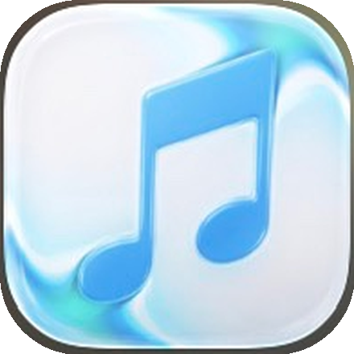

# FENG MUSIC

**为 iPhone 打造的免费本地音乐播放器**

## 为什么做这个

在 App Store 和 各个软件源 里找了很久，也没找到一个**好用又免费**的本地音乐播放器：要么收费订阅，要么广告满天飞，要么连歌词和封面都读不全。

找不到，那就自己做一个。FENG MUSIC 只做一件事：**把本地音乐的核心体验做到位**——导入、整理、歌词、播放，一个都不能将就；不做会员，不塞广告，不上传你的任何数据。

## 核心功能

- **导入即识别**：从「文件」批量导入 MP3 / FLAC / M4A，自动读取内嵌封面、LRC 同步歌词与标签，不用手动整理；iOS 导入的歌曲永久入库，重启不丢失
- **安卓同样完整**：Android 版支持扫描本机音乐库、持久化关联文件夹，还能直接解析歌曲文件内嵌的歌词（MP3 / FLAC / M4A）
- **曲库井井有条**：歌曲、专辑、歌手、歌单四种视图自动归类，专辑与歌手支持排序与收藏置顶，大曲库滚动依然流畅
- **好看的界面**：深色玻璃拟态，播放页背景随封面取色生成动态流光，配上律动波纹
- **歌词是认真的**：滚动同步歌词（支持双语对照）、歌词偏移 ±10s 微调、站内编辑 LRC，歌词不对自己就能改
- **歌词分享海报**：喜欢的歌词一键生成海报，三种风格（流光溢彩 / 极夜黑胶 / 晨曦磨砂），自带 FENG MUSIC 署名
- **无界海报画布**：整个曲库变成一面可以无限滑动的海报墙，点开即播
- **舞台歌词**：横屏时歌词铺满整个屏幕；锁屏歌词、灵动岛、画中画歌词也都有
- **五段均衡器**：点阵流光跟着频谱呼吸，哈曼等预设曲线 + 自定义预设
- **专辑与歌手资料**：自动补全专辑信息与歌手简介（数据来自 MusicBrainz / Wikipedia）
- **桌面小组件**：iOS 与 Android 都有，封面、进度、切歌在桌面就能完成
- **今日音乐签**：每天从你的曲库里抽一首歌配一句签语，打开 App 先收获一个小期待
- **白噪音空间**：12 种环境声（窗边细雨、深夜海浪、壁炉篝火、黑胶底噪、绿皮火车……）自由叠加混音、逐项调音量，8 个场景预设，助眠专注都能用
- **听歌足迹**：累计听歌次数、聆听时长、单曲循环榜 TOP 20，你的口味有据可查
- **播放该有的全都有**：睡眠定时、播放倍速、列表 / 单曲 / 随机循环、播放队列、随心漫步、锁屏与灵动岛控制、离线播放
- **数据在自己手里**：全部本地存储，不联网也能听；歌单与统计支持 JSON 备份导出 / 恢复

一点小个性化：可以换壁纸、选封面形态（圆角 / 黑胶 / 圆形）、调歌词字号，再打开星星之火、冬日飘雪、流光萤火、夜樱花瓣四种氛围特效——点到为止，不喧宾夺主。

## 截图

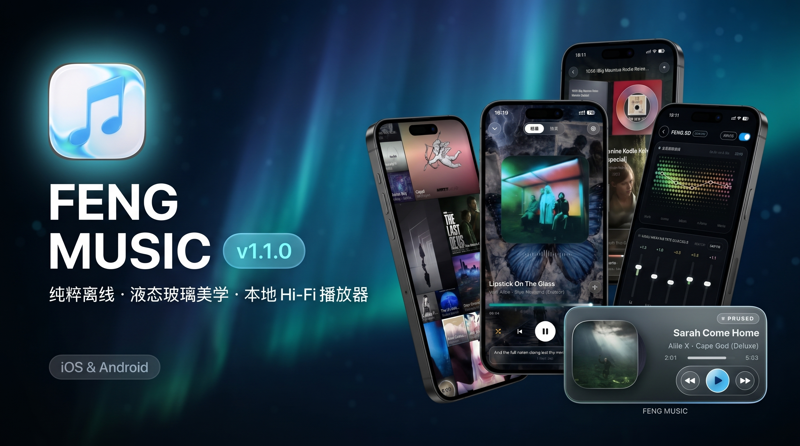

| 沉浸播放 | 锁屏歌词 |
| :---: | :---: |
| 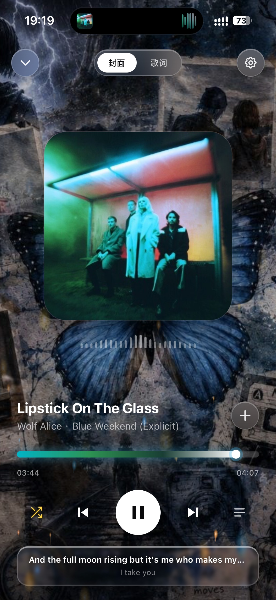 | 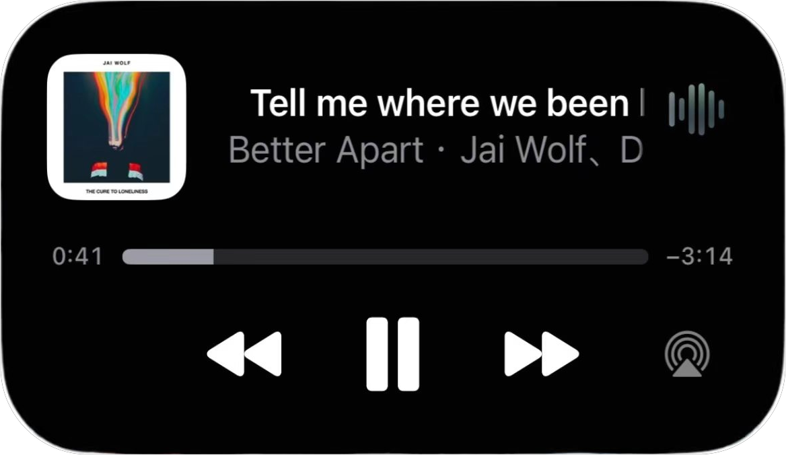 |
| 封面流光背景、律动波纹 | 锁屏不解锁，也能看词 |

| 无界海报画布 | EQ 点阵流光 |
| :---: | :---: |
| 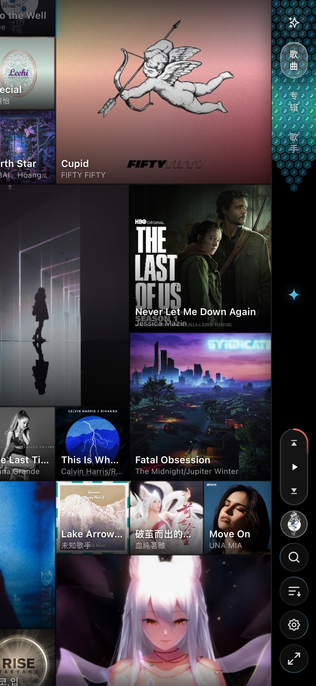 | 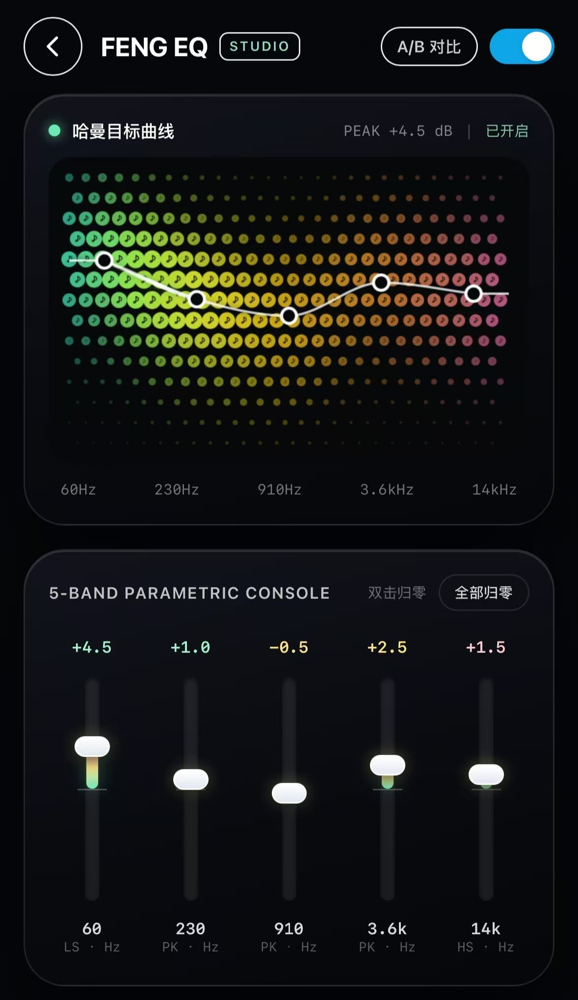 |
| 整个曲库，一面无限滑动的海报墙 | 点阵跟着频谱呼吸 |

| 专辑详情 | 歌手 |
| :---: | :---: |
| 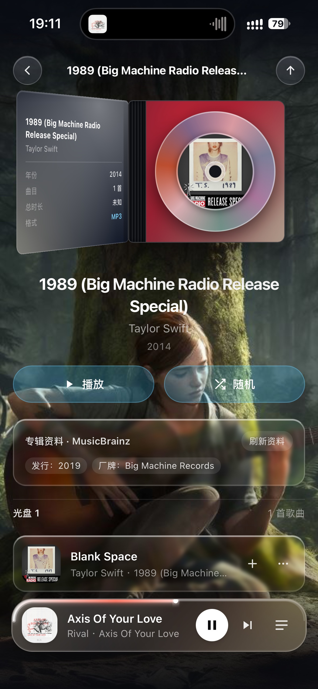 | 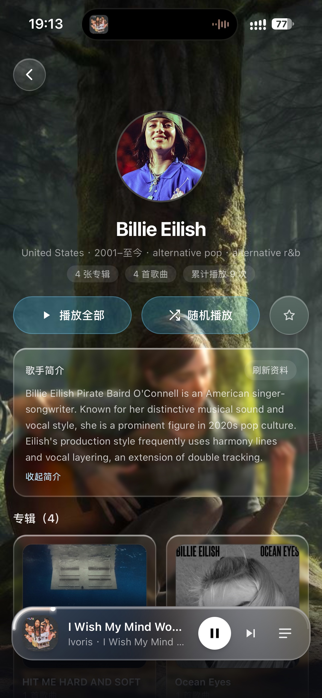 |
| CD 盒主视觉，资料来自 MusicBrainz | 歌手简介与照片自动补全 |

| 歌单 | 今日音乐签 |
| :---: | :---: |
| 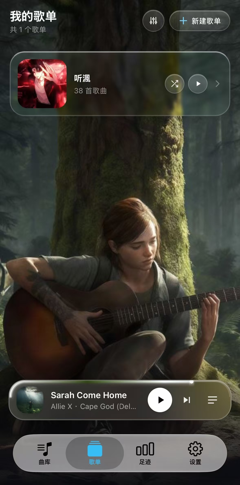 | 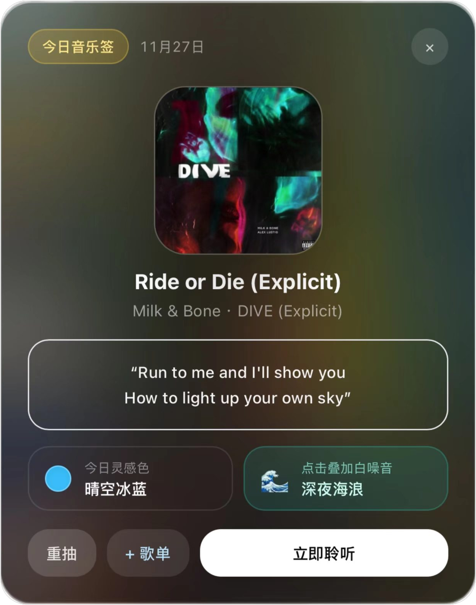 |
| 歌单封面与排序 | 每日一签，从你的曲库里抽一首给你 |

| 听歌足迹 | 白噪音空间 |
| :---: | :---: |
| 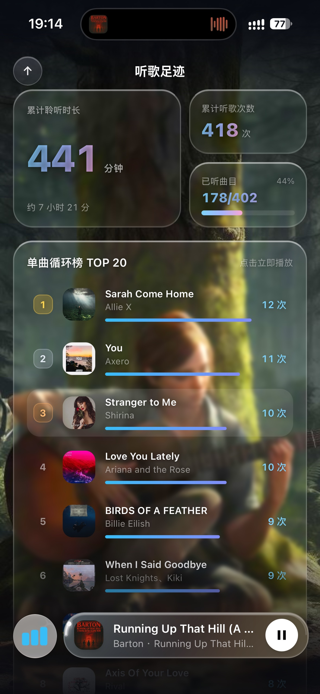 | 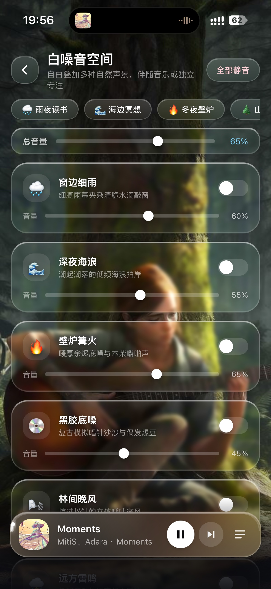 |
| 时长、次数与单曲循环榜 | 12 种自然声景自由叠加混音 |

| 歌词分享海报 | 安卓小组件 |
| :---: | :---: |
| 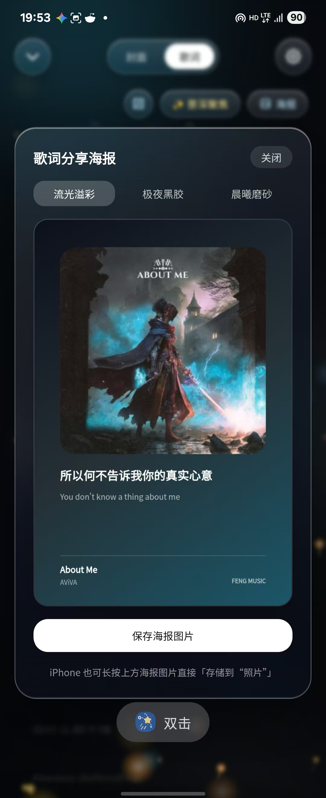 | 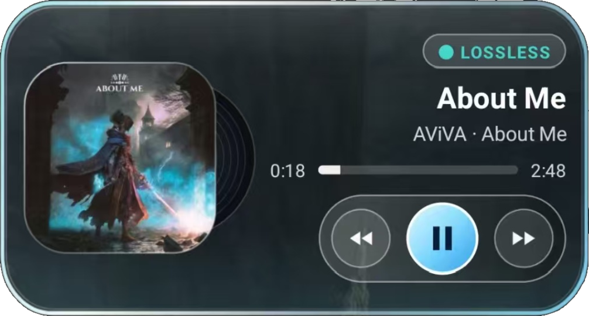 |
| 喜欢的歌词，生成一张海报再分享 | 桌面看封面、进度，切歌 |

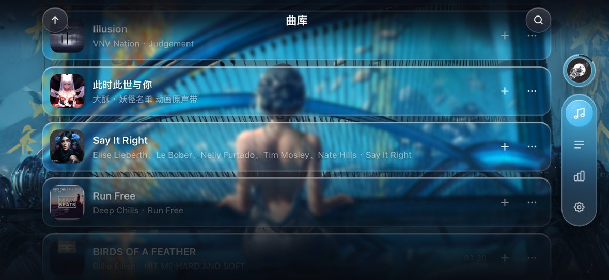

横屏适配：侧边 Dock 栏

## 安装（iPhone）

**方式一：添加到主屏幕（免安装）**

1. 用 Safari 打开：https://suifeng1.cc.cd/radio.html
2. 点底部分享按钮 →「添加到主屏幕」
3. 从桌面打开 FENG MUSIC，导入你的音乐文件即可

全屏 App 体验：无浏览器地址栏，支持锁屏切歌、灵动岛显示，导入的音乐全部离线可播。

**方式二：IPA 自签安装**

提供 IPA 安装包，可自行签名安装到 iPhone：

- 到 [Releases](https://github.com/Feng-Hypert/Feng/releases) 下载最新 IPA
- 用 AltStore / SideStore 等自签工具安装（普通 Apple ID 自签有效期 7 天，到期续签一次即可）
- 支持 TrollStore 的机型可直接永久安装

## 安装（Android）

- 到 [Releases](https://github.com/Feng-Hypert/Feng/releases) 下载最新 APK，直接安装即可
- 首次打开会自动扫描本机音乐库；也可以在「Android 添加音乐」里关联音乐文件夹，歌词文件（.lrc）会自动配对

## 说明

- 截图中的专辑封面与歌曲信息来自本地音乐文件自带的标签，仅作界面演示
- 本项目为个人作品，音乐文件请自行准备

## License

本项目以 [GNU AGPL-3.0](LICENSE) 协议开源。

FENG MUSIC 是为了打破收费束缚而做的App：任何人都可以免费使用、修改和分发它；但如果你基于它发布改进版本，也必须以同样的协议开源——让这份自由一直传下去。
